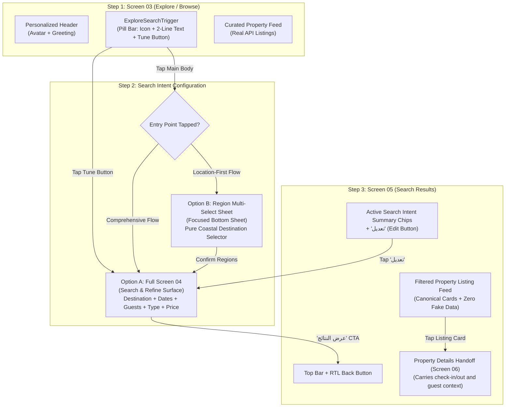

# KONFRM — Customer Screen 04 & Search Journey Design Review
## Architectural Specification & Founder Decision Framework

**Document ID:** `DESIGN_REVIEW_SCREEN_04_REGION_SELECTOR_SCREEN_05`  
**Target App:** Native Flutter Customer Application  
**Journey Scope:** Screen 03 (Explore Trigger) → Screen 04 (Search & Refine) / Region Multi-Select Bottom Sheet → Screen 05 (Search Results)  
**Governing Canon:** `DESIGN_SYSTEM/MOBILE_DESIGN_FOUNDATION.md` (v1.7), `docs/BUSINESS_RULES.md`, `.agents/skills/konfrm-design/SKILL.md`  
**Review Status:** FOUNDER DESIGN PROPOSAL & DECISION GATE  
**Implementation Mode:** READ-ONLY DESIGN SPECIFICATION (Zero unapproved code execution)  

---

## 1. Executive Context & Objective

With the Founder's approval of the **Screen 03 Premium Personalized Header** and compact **Pill Search Trigger** on Samsung Galaxy A56 physical hardware, the top of the Explore feed is established.

The pill search trigger (`ExploreSearchTrigger`) serves as the gateway into the search experience. Per Founder direction:
> *"Screen 04 (Search & Refine), the approved Region Multi-Select Bottom Sheet, and Screen 05 (Search Results) must be considered together as one coherent UX journey, but their full visual designs have not yet received Founder approval.*  
> *Do not independently design, implement, or approve the complete filter interface... Preserve the existing approved multi-region selection rules. Do not silently equate the region selector with all advanced filters."*

This document provides the authoritative design and architectural blueprint for the complete 3-step search journey, detailing the interaction models, visual hierarchy, business invariants, and technical realities before any Flutter authoring begins.

---

## 2. The Coherent 3-Step Customer Search Journey



---

## 3. Structural Analysis: Screen 04 vs. Region Multi-Select Bottom Sheet

A critical architectural distinction must be resolved regarding how the user configures search intent:

### The Essential Distinction:
- **The Region Multi-Select Bottom Sheet** is a lightweight, focused destination picker specifically optimized for Egyptian coastal travel ("الساحل الشمالي", "مراسي", "هاسيندا", "رأس الحكمة", "العلمين", "الجونة", etc.).
- **Screen 04 (Search & Refine)** is the comprehensive parameter surface that combines destination, stay dates, guest count, unit types, and price ceilings.

### Proposed Surface Hierarchy Models for Founder Decision:

#### Model 1: Two-Tier Contextual Hierarchy (Recommended)
- **Tapping the Main Search Pill (`ExploreSearchTrigger` body):** Opens the **Region Multi-Select Bottom Sheet** directly. This honors customer mental model #1 (*"Where do you want to go?"*). Once regions are chosen, tapping "متابعة" advances into Screen 04 (or directly executes search if only destination is needed).
- **Tapping the Tune Button (`tune` icon on physical left):** Opens **Screen 04 (Search & Refine)** directly, with all advanced filters accessible immediately.
- **Inside Screen 04:** The destination field itself acts as a trigger that opens the Region Multi-Select sheet if the user wants to adjust regions.

#### Model 2: Unified Full-Screen Hub (`FULL_PAGE_NESTED`)
- Tapping *anywhere* on the search trigger opens **Screen 04** as a dedicated full-page screen.
- Destination selection is an inline tap-to-select accordion/dropdown within Screen 04 (matching the React web prototype).
- Clean, single-screen mental model; avoids sheet-over-sheet stacking.

#### Model 3: Modal Bottom Sheet Hub (`BOTTOM_SHEET`)
- Screen 04 itself is presented as a large modal bottom sheet (16px top radius, 85% viewport height).
- Dismissable via downward swipe, backdrop tap, or close button (`X`).
- Avoids full route transitions, keeping the user anchored to the Explore feed context.

---

## 4. Multi-Region Selection Rules & Business Invariants

Egyptian coastal vacation rentals have unique geographic characteristics. Guests frequently consider multiple adjacent villages or compounds simultaneously (e.g. searching *Marassi* AND *Hacienda White* together).

### Governing Multi-Region Rules:
1. **Multi-Selection Freedom:** Customers can select 1, 2, 3, or more destinations simultaneously.
2. **Zero Mandatory Typing:** Pure tap-to-select interaction (chips or list items with checkboxes). No awkward mobile keyboard appearance unless fuzzy search is explicitly triggered.
3. **Truthful Dynamic Summary Grammar:**
   - **0 selected:** `"كل الوجهات (اختياري)"` / `"إلى أين تريد الذهاب؟"`
   - **1 selected:** `"[اسم المنطقة]"` (e.g. `"مراسي"`)
   - **2 selected:** `"[اسم المنطقة الأولى] + 1"` (e.g. `"مراسي + 1"`)
   - **3+ selected:** `"[N] وجهات محددة"` (e.g. `"3 وجهات محددة"`)
4. **Instant Reset Affordance:** Explicit `"مسح الوجهات"` or `"مسح التحديد"` button whenever 1+ regions are selected.
5. **No Fake Hierarchies:** Clear grouping by coastal macro-region (e.g., *الساحل الشمالي*, *البحر الأحمر*, *العين السخنة*) with immediate multi-selection of sub-resorts.

---

## 5. Technical Reality: Backend Search Contract vs. Product Intent

To prevent engineering delusions, the design review establishes the exact API and persistence reality:

### Current Backend Implementation Reality:
- **API Endpoint:** `GET /api/v1/customer/properties/search`
- **Supported Parameters:**
  - `destinations`: comma-separated terms (e.g. `destinations=الساحل,مراسي`)
  - `unitType` / `unitTypes`: comma-separated enums (`APARTMENT,CHALET,VILLA,STUDIO`)
  - `guests`: positive integer (filters `maxGuests >= guests`)
  - `maxPrice`: positive number (filters `basePricePerNight <= maxPrice`)
- **Matching Mechanism (`dbRepository.ts:searchPublic`):**
  - Destination filtering performs **case-insensitive substring matching** across four database fields:
    $$\text{title.includes(term)} \lor \text{address.includes(term)} \lor \text{region.includes(term)} \lor \text{resortName.includes(term)}$$
  - There is **NO exact relational enum** or foreign-key table for regions.
- **Metadata Availability:**
  - There is **NO** dedicated `GET /api/v1/customer/regions` or `GET /api/v1/customer/metadata` endpoint.
  - The React web prototype derives available destinations dynamically via `extractFilterMetadata()` from the published property feed's unique `resortName` and `region` attributes.

### Architectural Imperative for Native Flutter:
- The Flutter client must **NOT invent fabricated endpoints**.
- The client will dynamically harvest available destinations from the public property feed (or use a verified coastal hierarchy map that strictly maps to canonical `resortName` and `region` strings).
- If the feed is loading or unavailable, fail-closed handling displays a graceful loading spinner or neutral retry banner.

---

## 6. Critical Invariant: Date Search Intent vs. Availability Truth

> [!CAUTION]
> ### NON-NEGOTIABLE CANONICAL INVARIANT (MR-11 & P5/C2)
> **The public search API does NOT guarantee server-side date availability filtering.**
>
> 1. Check-in and check-out dates entered on Screen 04 represent **CUSTOMER SEARCH INTENT ONLY**.
> 2. Dates are validated locally against canonical product rules:
>    - Minimum stay: **2 nights** (`SEARCH_STAY_TOO_SHORT`).
>    - Maximum stay: **30 nights** (`SEARCH_STAY_TOO_LONG`).
>    - No past dates: must be $\ge \text{today}$ in local Cairo time.
>    - Strict chronological order: check-out must be after check-in.
> 3. Dates are **NEVER sent as availability parameters** to `/api/v1/customer/properties/search`.
> 4. Screen 05 (Search Results) must **NEVER claim** *"الوحدات المتاحة في تواريخك"* (Properties available on your dates). It must truthfully display *"بحثك: [التواريخ]"* (Your search intent).
> 5. True availability and calendar blocking are verified strictly on Screen 06 (Property Details) via `GET /api/v1/customer/properties/:id/availability`.

---

## 7. Detailed Visual & Interaction Specifications

### Screen 04: Search & Refine (`SearchRefineView`)

| Section | UI Control & Tokens | RTL Layout & Behavior |
| :--- | :--- | :--- |
| **Header** | Sticky white bar (`#FFFFFF`), 1px bottom border (`#F1F5F9`) | RTL Back button (`ArrowRight`, 44dp hit target) on physical right; title `"ابحث عن إقامتك"` in Cairo SemiBold 18sp. |
| **Destination** | Structural card container (12px radius, `#F8FAFC` fill, 1px `#E2E8F0` border) | Pin icon (`#0059FF`) on physical right, selected summary in Cairo Bold 14sp, chevron on physical left. Tapping opens Region Multi-Select sheet. |
| **Dates (Intent)** | Split 2-column input (`الوصول` / `المغادرة`), 8px control radius | Dual date picker or inline calendar. Shows computed nights badge (e.g. `"3 ليالٍ"`). Clear action `"مسح التواريخ"` when populated. |
| **Guests** | Stepper row with 44×44dp touch buttons (`−` and `+`) | Center display: `"[N] أفراد"` with polite live-region announcement. Decrement disabled at 1. |
| **Unit Types** | Horizontal scrollable chip row (8px radius, 44dp min height) | Options: `الكل`, `شقة`, `شاليه`, `استوديو`, `فيلا`. Active: `#000000` fill with white text. Inactive: `#F8FAFC` with `#0F172A` text. |
| **Price Ceiling** | Drag slider with `#000000` accent, 1,000 EGP to inventory ceiling | Dynamic ceiling computed from current published listings. Shows formatted label: `"حتى 15,000 ج.م / ليلة"` or `"بدون حد أقصى"`. |
| **Bottom Sticky CTA** | 54dp height, 6px radius, Stable Black `#000000` | Full-width button: `"عرض النتائج"` (Show Results). Disabled if date range is invalid. |

---

### Screen 05: Search Results (`SearchResultsView`)

| Component | Visual Specification | Functional Role |
| :--- | :--- | :--- |
| **Top Navigation** | Sticky bar with RTL Back button (`ArrowRight`) | Returns smoothly to Screen 03 (Explore) or Screen 04. |
| **Active Intent Bar** | Horizontal chip track with subtle gray surface (`#F8FAFC`) | Displays individual intent chips (`الوجهات`, `التواريخ`, `الضيوف`, `نوع الوحدة`, `الحد الأقصى`). |
| **Edit Affordance** | `"تعديل"` button with `SlidersHorizontal` icon (44dp target) | Reopens Screen 04 with all current filters preserved without resetting scroll offset. |
| **Listing Feed** | Vertical scroll view using canonical `PropertyCard` widgets | Displays thumbnail photo carousel, title, resort/region tag, nightly rate (`13,500 ج.م`), and favorite heart toggle. |
| **Zero Matches State** | Centered graphic + Cairo Bold 16sp heading | Plain Arabic explanation: *"لا توجد إقامات تطابق معايير البحث"* with CTA *"إعادة ضبط الفلاتر"*. |
| **Card Navigation** | Single tap on listing card | Pushes Screen 06 (`PropertyDetailsView`), passing `checkIn`, `checkOut`, and `guests` as pre-filled booking context. |

---

## 8. Mobile Design Foundation (DF2) & Typography Alignment

| Element | Governing Token / Value | Rule / Justification |
| :--- | :--- | :--- |
| **Typography Family** | **Cairo** (Profile B — Mobile Balanced) | Sole typography authority across all native customer screens. |
| **Screen Titles** | Cairo SemiBold 18sp / 1.35 line-height | Clear, restrained title hierarchy; anti-generic SaaS. |
| **Section Labels** | Cairo Bold 13sp / 1.4 line-height, `#0F172A` | Explicit labels above form fields (Outline-Led field strategy). |
| **Primary Buttons** | **`#000000`** Stable Black, **`6px`** radius | Phase 4C Action Canon; 54dp touch height. |
| **Form Fields** | **`8px`** radius, 1px `#E2E8F0` border, `#F8FAFC` fill | Phase 4D Form Canon; distinct from 6px action buttons. |
| **Structural Containers** | **`12px`** radius, `#F8FAFC` surface | Phase 4E Structural Canon; role-aware containment. |
| **Bottom Sheet Radius** | **`16px`** top radius (`Radius.vertical(top: Radius.circular(16))`) | Phase 4F Navigation Canon. |
| **Currency Rendering** | **`KonfrmPriceText`** (`Directionality.rtl`) | Number-first Arabic layout (`13,500 ج.م`) guaranteed across all viewports. |

---

## 9. State Management & Architecture Blueprint

```text
mobile/apps/customer_app/lib/features/discovery/
├── data/
│   ├── public_property.dart                      (Canonical Listing DTO)
│   ├── public_property_search_repository.dart    (HTTP Search Client & Query Builder)
│   └── search_intent_models.dart                 (SearchIntent, FilterMetadata, Validation)
├── presentation/
│   ├── explore_view.dart                         (Screen 03: Explore Feed)
│   ├── search_refine_view.dart                   (Screen 04: Search & Refine Full Screen)
│   ├── search_results_view.dart                  (Screen 05: Filtered Listings Feed)
│   ├── state/
│   │   ├── search_intent_controller.dart         (Riverpod Notifier for SearchIntent)
│   │   └── search_results_controller.dart        (Riverpod AsyncNotifier for Results)
│   └── widgets/
│       ├── explore_header.dart                   (Screen 03: Personalized Header)
│       ├── explore_search_trigger.dart           (Screen 03: Compact Pill Search Trigger)
│       ├── region_multiselect_sheet.dart         (Region Multi-Select Bottom Sheet)
│       ├── stay_dates_intent_picker.dart         (Screen 04: Date Range Picker)
│       ├── guest_stepper_field.dart              (Screen 04: Guest Counter)
│       ├── unit_type_selector.dart               (Screen 04: Unit Type Chips)
│       ├── price_ceiling_slider.dart             (Screen 04: Dynamic Price Slider)
│       └── search_intent_summary_bar.dart        (Screen 05: Active Filter Chips Bar)
```

---

---

## 10. Finalized Founder Architectural Decisions

The Founder has reviewed the proposal and established the canonical architectural direction for the Customer Search Journey:

### 1. Screen 04 Surface Presentation:
- **Decision:** **Full-Page Route (`FULL_PAGE_NESTED`)**.
- **Rationale:** Screen 04 is a dedicated, focused page with top sticky navigation (`ArrowRight` back button to Screen 03), maximizing vertical space for the calendar, guest counter, unit types, and price slider without sheet detent constraints or modal nesting friction.

### 2. Screen 03 Search Trigger Interaction:
- **Decision:** **Two-Tier Entry**.
- **Behavior:**
  - Tapping the **main pill body** (`إلى أين تريد الذهاب؟` / search icon) opens the **Region Multi-Select Bottom Sheet** directly (location-first focus).
  - Tapping the **tune/filter icon** on the physical left opens **Screen 04 (Search & Refine)** directly with all advanced filters accessible immediately.

### 3. Screen 05 Active Filter Chips:
- **Decision:** **Hybrid Interactive Filter Chip Model**.
- **Exact Interaction Specification:**
  - Each active filter chip implements **two distinct, accessible touch targets**:
    1. **Chip Label / Body Tap:** Tapping the body opens the specific filter editor with existing selections preserved (e.g. tapping `[شاليه]` opens the unit type selector; tapping `[15–18 يوليو]` opens the date picker).
    2. **Explicit (×) Control Tap:** Tapping the dedicated, accessible close button removes *only that specific filter* and refreshes Screen 05 results in place.
  - **Aggregated Multi-Region Chip:** When multiple regions are active (e.g. `مراسي + 1`), tapping the chip body opens the Region Multi-Select editor. Tapping the body must **never** silently clear all selected regions.
  - **State Preservation:** Unrelated filters are strictly preserved when editing or removing a specific filter.
  - **Cross-Screen Sync:** Filter state remains perfectly synchronized across Screen 03, Screen 04, and Screen 05.
  - **Truthful State Handling:** Zero-match queries render an explicit, helpful empty-results view; the app must **never** silently fall back to all properties.
  - **Accessible Styling:** Strict 44dp touch regions, accessible contrast, and consistent KONFRM rounded geometry.

---

## 11. Next Steps & Scope Boundary
This architectural specification establishes the governed foundation for the upcoming search implementation contract. As directed by the Founder:
> *"This is the selected UX direction for design review, not permission to implement or approve unreviewed screens, business rules, or backend changes."*

No code modifications to Screen 04, Screen 05, or backend services will occur until an approved execution task contract is formally issued.
